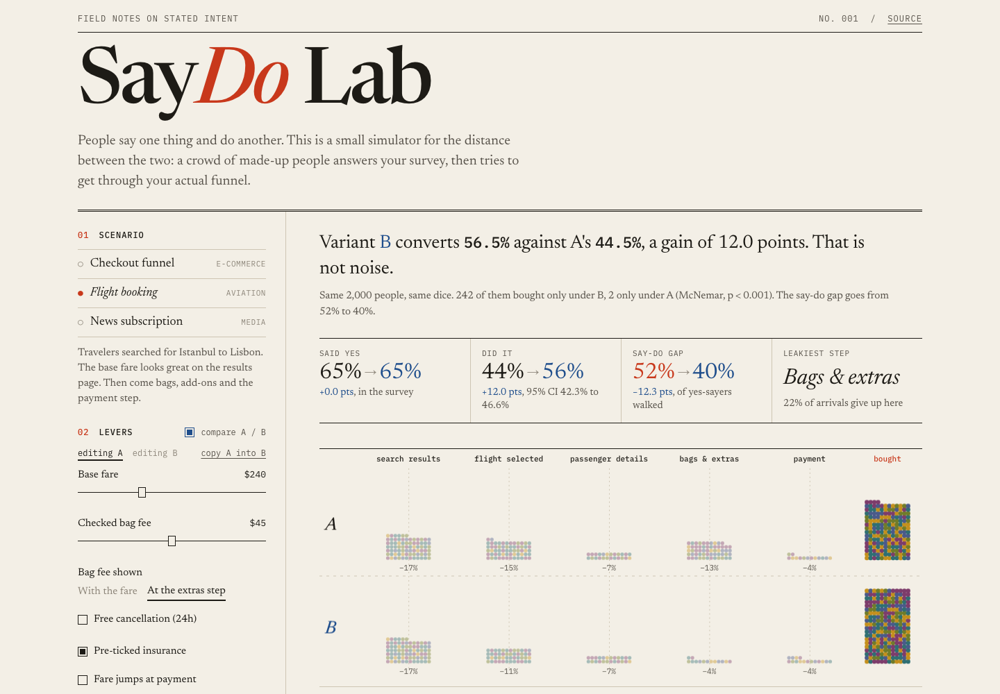
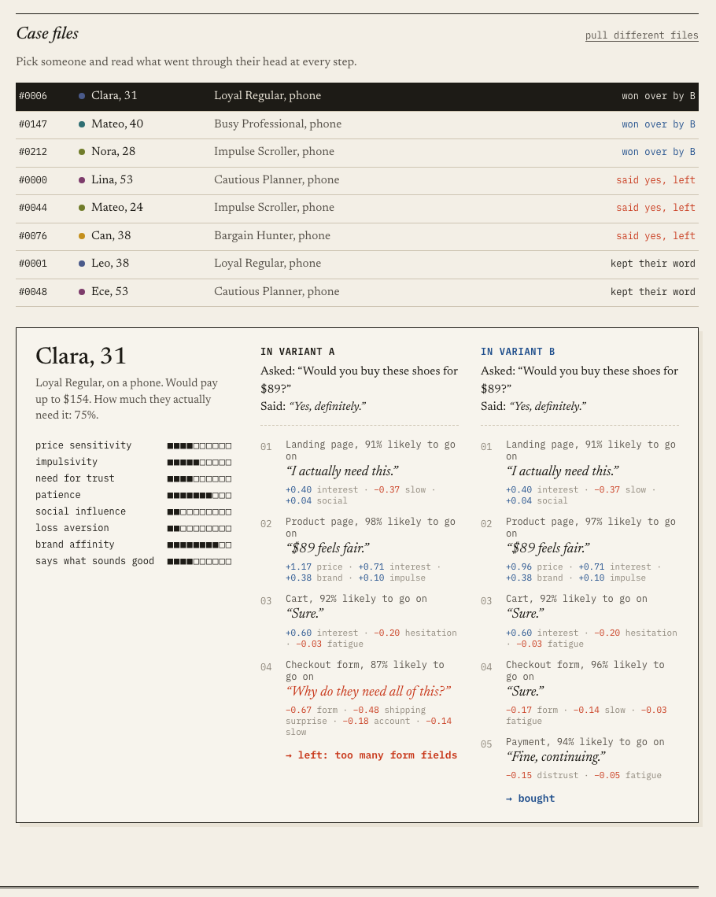

# SayDo Lab

People say one thing and do another. Ask a group of shoppers whether they'd buy
something at $89 and most of them will say yes. Put the same people through a
real checkout and a lot of those yeses quietly disappear somewhere between the
cart and the payment page.

This project simulates both halves of that. A crowd of made-up people answers
a survey question, then walks through an actual funnel one step at a time. You
can see how many of them break their word, where it happens, and which design
change would have kept them.

Live version: https://berkayacer13.github.io/saydo-lab/



## The idea

Surveys only see the headline. They don't see the $9 shipping fee that shows
up at checkout, the 14-field passenger form on a phone, or the countdown timer
that makes a careful person close the tab. People also like giving the nice
answer.

So each simulated person here has two models:

- a **survey model**, which looks at the price, their willingness to pay, how
  much they actually need the thing, and how much they like saying what
  sounds good
- a **behaviour model**, which takes them through every step of the funnel.
  At each step a handful of forces (price, hidden fees, form length, trust,
  urgency, page speed and so on) push them forward or back

The difference between those two is the say-do gap. With the default settings
it comes out at about 54% for the shoe store, 52% for the flight and 90% for
the news subscription. Nobody types those numbers in; they fall out of the
model. The news one is meant to be extreme. "I'd pay for good journalism" is
probably the most famous broken promise on the internet.

## What's in the app

- **Three funnels:** an online shoe store checkout, a flight booking (Istanbul
  to Lisbon) and a news site paywall. Each has its own five kinds of people,
  e.g. Bargain Hunter, Family Planner, Media Skeptic.
- **Levers** for whatever you'd normally argue about in a meeting: price, when
  the shipping or bag fee is shown, guest checkout, form length, trust badges,
  countdown timers, pre-ticked insurance, clickbait level, trial length...
- **A/B mode.** The same people go through both versions with the same random
  numbers, so a difference can only come from the change you made. The
  significance test is McNemar's, run on the people whose outcome flipped.
- **Why they left.** Every drop-off is blamed on whatever was pushing hardest
  at that moment.
- **Which lever matters.** Each lever gets pushed to both of its extremes and
  ranked by how much it moves conversion. Click a row to try the best setting
  as variant B.
- **Case files.** Open any person and read what went through their head at
  each step, side by side for A and B.



Some things that came out of playing with it:

- Hiding the shipping fee doesn't change a single survey answer (the survey
  never mentions it), but the say-do gap goes up.
- A countdown timer does almost nothing to overall conversion. It wins
  impulse buyers and loses careful ones, and those two roughly cancel out.
- Clickbait gets more clicks and fewer subscribers.
- Cutting form fields never loses anyone. In paired runs, the people it
  affects only ever move from "left" to "bought".

## Running it

Needs Node 18 or newer. There are no dependencies to install.

```bash
git clone https://github.com/Berkayacer13/saydo-lab.git
cd saydo-lab
npm start        # http://localhost:5173
npm test
```

There's also a command line version that uses the same engine:

```bash
node cli/saydo.js checkout
node cli/saydo.js checkout --list
node cli/saydo.js flight --compare "bagReveal=upfront,preTicked=false"
node cli/saydo.js paywall --sensitivity
node cli/saydo.js checkout --persona 12
node cli/saydo.js checkout --set price=79 --n 5000 --seed 7 --json
```

```
Paired A/B result  (same personas saw both variants)
  Conversion 44.5% → 52.0%  +7.6 pts  p < 0.001, McNemar
  173 personas converted only with B, 22 only with A.
```

The web app reads its setup from the URL, so you can link to an experiment:

```
#flight
#checkout&b.guestCheckout=true&b.shippingReveal=upfront
#paywall&b.clickbait=0&b.trialDays=14
```

## Code

```
src/            the simulation itself, plain ES modules
  rng.js        seeded random numbers
  persona.js    traits and crowd generation
  scenarios.js  the three funnels: levers, segments, survey and step forces
  simulate.js   journeys, cohorts, paired A/B, sensitivity sweep
  reasons.js    drop-off reasons and the inner monologue lines
  stats.js      Wilson interval, z-test, McNemar
web/            the page (no framework, the crowd is drawn on a canvas)
cli/saydo.js    command line version
test/           node:test suite
```

The same `src/` files run in the browser and in Node. To add a funnel, add an
object to `src/scenarios.js` with its steps, levers and segments. The page, the
CLI and the tests pick it up from there.

How the maths works, with formulas: [docs/MODEL.md](docs/MODEL.md).

## Caveats

The coefficients are hand-tuned to give believable numbers. They are not
fitted to real data. Treat the output as a way to reason about *why* intent and
behaviour drift apart, not as a forecast for your store. The obvious next steps
would be:

- fit the traits and force weights to real funnel analytics plus a survey panel
- let a language model write the inner monologue, with the numeric model
  still deciding what happens
- have people react to actual ad creatives and page screenshots
- add a B2B scenario where several people have to agree before anyone buys

## License

MIT
