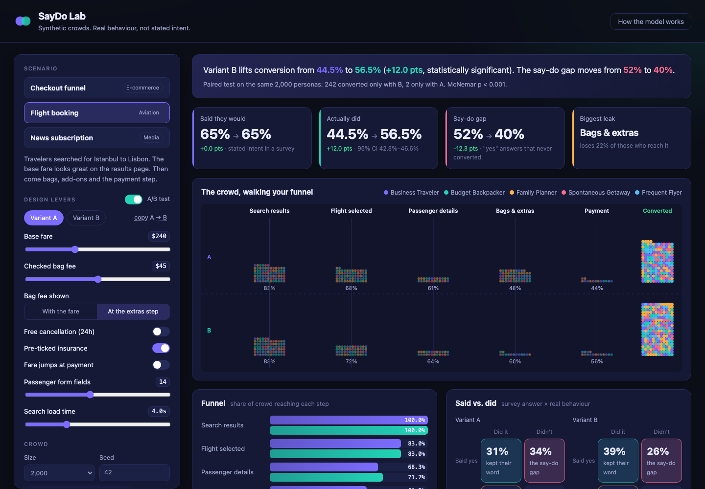
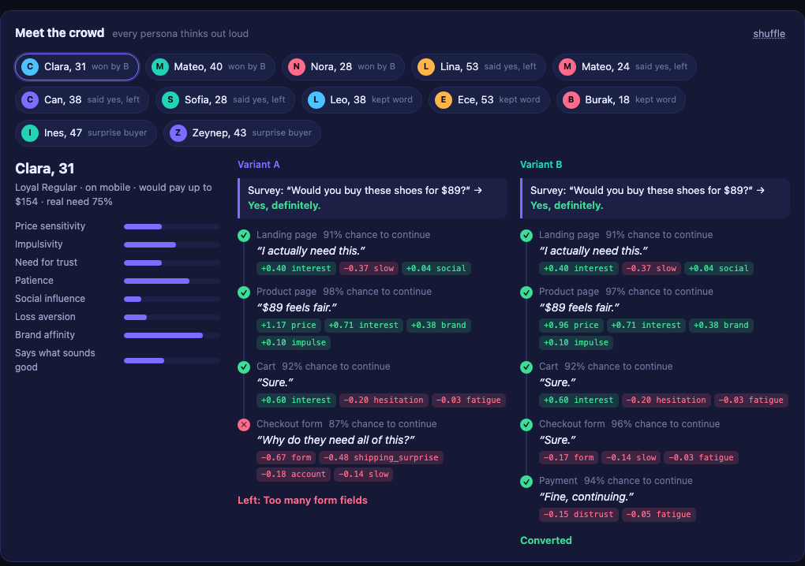

# SayDo Lab

**Synthetic crowds that show the gap between what people *say* and what they actually *do*.**

Ask 2,000 shoppers whether they'd buy your product and two thirds say yes. Put
the same 2,000 people through your real checkout and fewer than half of those
"yes" answers turn into orders. Surveys can't see the friction, the surprise
fees, the slow pages, or the moment someone just gets bored.

SayDo Lab simulates both sides. Every synthetic persona answers your survey,
then walks your actual funnel step by step and thinks out loud as they go. You
see *how many* people break their promise, *where*, *why*, and *which design
change* would keep them.

**▶ [Live demo](https://berkayacer13.github.io/saydo-lab/)**: runs entirely in the browser, no install.



---

## What you can do with it

- **Measure the say-do gap.** Each persona answers a survey ("Would you book this
  flight for $240?") and then actually goes through the booking flow. The
  *Said vs. did* matrix shows who kept their word, who broke it, and who said
  no but bought anyway.
- **See why people leave.** Every drop-off is attributed to the force that
  pushed hardest at that moment: *surprise shipping fee*, *too many form fields*,
  *pressure tactics backfired*, *clickbait put them off*...
- **Run paired A/B tests on the same people.** The same synthetic crowd sees both
  variants with identical random draws, so differences come from the design
  change and not from noise. Significance comes from McNemar's test on the
  personas whose outcome flipped.
- **Find what moves the needle.** A sensitivity sweep ranks every design lever by
  impact. Click any row to try its best setting as Variant B.
- **Meet the crowd.** Open any persona to see their traits, their survey
  answer, and their inner monologue at every step. In A/B mode you see the same
  person living through both variants side by side.



## Scenarios

| Scenario | Sector | Funnel | Levers |
| --- | --- | --- | --- |
| **Checkout funnel** | E-commerce | Landing → Product → Cart → Checkout → Payment | price, shipping fee & when it's shown, reviews, trust badges, countdown timer, guest checkout, form length, load time |
| **Flight booking** | Aviation | Results → Select → Passengers → Extras → Payment | fare, bag fee & when it's shown, free cancellation, pre-ticked insurance, fare jump at payment, form length, search speed |
| **News subscription** | Media | Headline → Article → Paywall → Offer → Subscribe | clickbait level, price, free articles, trial length, ad density, load time |

Each scenario has its own population of 5 segments (e.g. *Bargain Hunter*,
*Family Planner*, *Media Skeptic*) built from 8 psychographic traits.

Some of the trade-offs the model brings out:

- Hiding the shipping fee doesn't change survey answers at all (the survey
  never mentions it), but it widens the say-do gap at checkout.
- A countdown timer barely moves total conversion. It wins impulse buyers and
  scares off cautious ones, and the segment table shows which group you lose.
- Clickbait gets more clicks but fewer subscribers. Curiosity pulls people in,
  and then credibility and disappointment cost you the conversion.
- Removing friction never hurts anyone. In the paired test, cutting form fields
  converts extra people and loses zero.

## Quick start

Requires Node.js 18+. **No dependencies.**

```bash
git clone https://github.com/Berkayacer13/saydo-lab.git
cd saydo-lab
npm start            # http://localhost:5173
npm test             # 14 tests, < 1s
```

### Command line

The same engine runs in the terminal:

```bash
node cli/saydo.js checkout                         # full report
node cli/saydo.js checkout --list                  # show levers
node cli/saydo.js flight --compare "bagReveal=upfront,preTicked=false"
node cli/saydo.js paywall --sensitivity
node cli/saydo.js checkout --persona 12            # one persona's inner monologue
node cli/saydo.js checkout --set price=79 --n 5000 --seed 7 --json
```

```
Paired A/B result  (same personas saw both variants)
  Conversion 44.5% → 52.0%  +7.6 pts  p < 0.001, McNemar
  173 personas converted only with B, 22 only with A.
```

```
What moves the needle?  base conversion 6.8%
  Monthly price                3.1% @ 19.99      22.6% @ 1.99      span 19.5 pts
  Headline clickbait level     4.0% @ 1           9.5% @ 0         span 5.5 pts
  Free trial (days)            6.8% @ 0          11.3% @ 30        span 4.5 pts
  Ad density                   4.5% @ 1           8.8% @ 0         span 4.3 pts
```

### Deep links

The web app reads its setup from the URL hash, so you can share a specific experiment:

```
/#flight
/#checkout&b.guestCheckout=true&b.shippingReveal=upfront
/#paywall&b.clickbait=0&b.trialDays=14
```

## How it works

```
  segments ──► crowd of personas ──┬──► survey model ──► "Would you buy?"  (SAY)
                                   │
                                   └──► funnel model ──► stage by stage     (DO)
                                                           ├─ forces → logit → P(continue)
                                                           ├─ friction → fatigue pool
                                                           └─ exit reason + inner monologue
```

1. **Personas** are drawn from segment trait distributions, each with a
   willingness to pay, a real underlying need (motivation) and a device.
2. **The survey model** sees only the headline price, plus a social-desirability
   bias. That is why it over-predicts.
3. **The funnel model** evaluates signed *forces* at every stage (price vs. WTP,
   hidden fees, form length, trust, urgency, clickbait...). Friction builds up
   into fatigue that weighs on later steps.
4. **Common random numbers** give every persona a private random stream, so
   A/B tests are paired and the McNemar test applies.

The full write-up, with formulas, is in **[docs/MODEL.md](docs/MODEL.md)**.

## Project structure

```
src/                 simulation engine (pure ES modules, shared by browser + CLI)
  rng.js             seeded PRNG, hashing, normal draws
  persona.js         trait model and crowd generation
  scenarios.js       funnels, levers, segments, survey and stage force models
  simulate.js        journeys, cohorts, paired A/B, sensitivity analysis
  reasons.js         exit-reason labels and think-aloud monologue templates
  stats.js           Wilson CI, two-proportion z-test, McNemar
web/                 dashboard UI (vanilla JS, canvas crowd animation)
cli/saydo.js         terminal interface
test/                node:test suite (behavioural sanity + statistics)
docs/MODEL.md        model documentation
```

## Adding a scenario

A scenario is a plain object in `src/scenarios.js`:

```js
{
  id: 'b2b-demo', sector: 'B2B', name: 'Demo request',
  referencePrice: 1200, currency: '$', priceOf: (L) => L.price,
  surveyQuestion: (L) => `Would you book a demo at $${L.price}/seat?`,
  segments: [ /* 5 segments with trait means */ ],
  levers:   [ /* range | toggle | select */ ],
  survey(p, L) { /* logit of saying yes */ },
  stages: [
    { id: 'pricing', label: 'Pricing page', base: 1.2,
      forces: (p, L) => [ f('price', ...), f('form', ..., true /* friction */) ] },
    // ...
  ],
}
```

The UI, CLI, A/B tests and sensitivity analysis all pick it up automatically.

## Roadmap

- **Calibrate against real data.** Fit segment traits and force weights to
  funnel analytics plus a stated-intent panel, then validate the simulated
  say-do gap on held-out campaigns.
- **LLM-voiced personas.** Swap template monologues for model-generated
  reasoning, keeping the numeric force model as the controller.
- **Creative testing.** Let personas react to actual ad images, headlines and
  landing page screenshots.
- **More sectors.** Retail store layouts, B2B buying committees with several
  decision-makers.

## License

MIT
